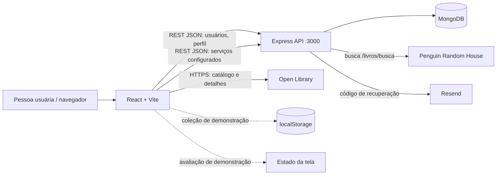
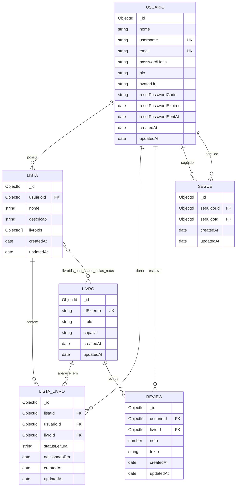
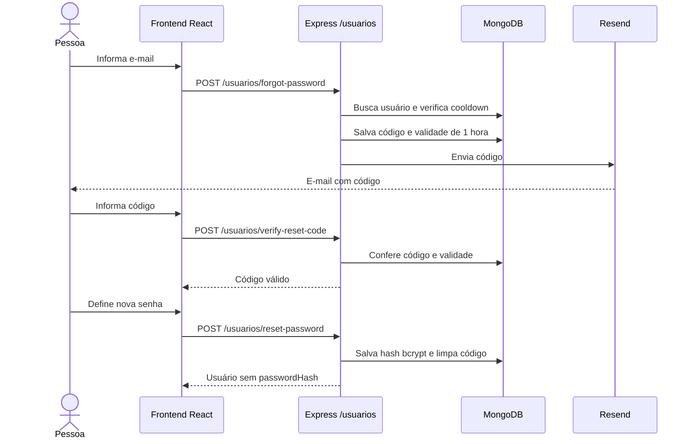
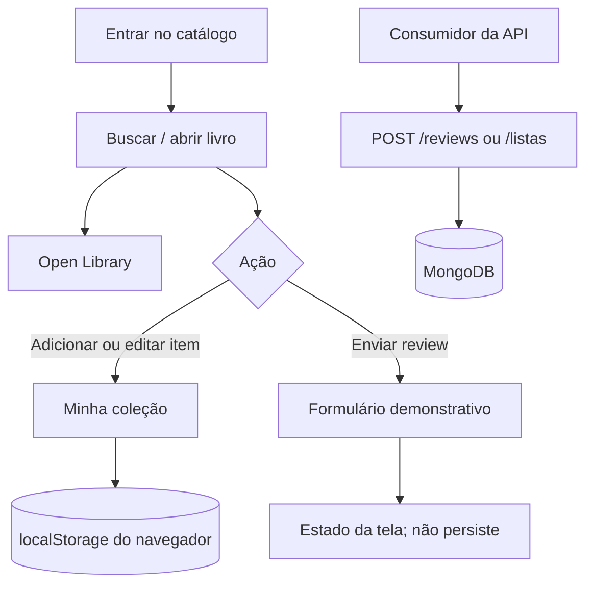

# Diagramas do BookHub

Os diagramas abaixo descrevem os componentes e os modelos atualmente implementados; relações sem endpoint funcional estão indicadas.

## Arquitetura e integrações

Observação: embora existam rotas de reviews e listas, a coleção e o formulário de review exibidos no frontend ainda não as utilizam.

## Modelo de dados (ER)

As referências são ObjectIds do MongoDB; o Mongoose `ref` dá suporte a `populate()`, mas não é uma chave estrangeira com integridade relacional automática. O campo `LISTA.livroIds` está no schema, enquanto as rotas persistem a relação em `LISTA_LIVRO`.

## Fluxo de recuperação de senha

## Fluxos disponíveis e suas persistências

